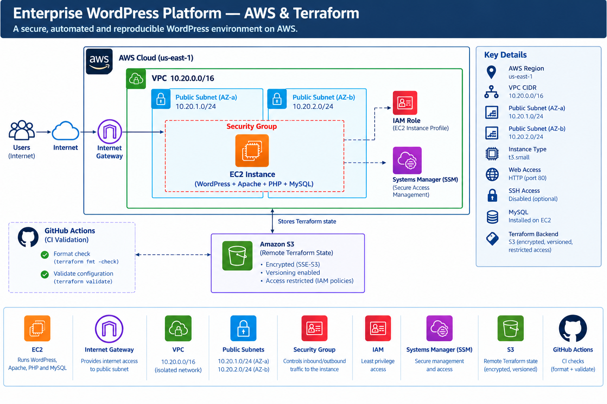

# Enterprise WordPress Platform: AWS & Terraform

> Simulated consulting engagement for a global technology enterprise.

## Executive Summary

This project demonstrates the design and implementation of a repeatable
WordPress platform on AWS using Terraform.

The objective was to replace manual infrastructure provisioning with a
modular, DRY and reproducible Infrastructure-as-Code solution.

The platform provisions:

- AWS networking
- Public subnets
- Internet connectivity
- Security controls
- EC2 compute
- IAM Systems Manager access
- WordPress
- MySQL
- Remote Terraform state
- CI validation

## Business Problem

The simulated client requires a standardized corporate WordPress platform
that can be reproduced across environments without relying on manual server
configuration.

The engineering objectives are:

- repeatability
- security
- consistency
- automation
- auditability
- maintainability
- operational simplicity

## Architecture

The following diagram illustrates the AWS infrastructure and supporting
CI workflow for this Terraform-managed WordPress platform.



*Figure 1: WordPress hosted on EC2, AWS networking and security controls,
Systems Manager access, remote Terraform state, and GitHub Actions validation.*


## Repository Structure

```text
enterprise-wordpress-platform-terraform/
├── bootstrap/
├── environments/
├── modules/
├── scripts/
├── docs/
└── .github/

```


```markdown
Deployment Lifecycle

Developer
   |
   v
GitHub
   |
   v
Terraform Code
   |
   v
terraform fmt
   |
   v
terraform validate
   |
   v
terraform plan
   |
   v
terraform apply
   |
   v
AWS Infrastructure
   |
   v
EC2 Bootstrap
   |
   v
WordPress
   |
   v
Smoke Test

```


---

## Consulting Perspective

The solution was intentionally designed around the business requirement
rather than around maximum technological complexity.

For the initial workload, a single EC2 WordPress platform provides a
cost-conscious and operationally simple solution.

The architecture deliberately avoids introducing Kubernetes or a
microservice platform where those technologies would not provide proportional
business value.

The architecture can evolve as business requirements grow.

## Production Evolution

Note that the current architecture is intentionally sized for the assignment and
portfolio demonstration.

>For a production enterprise implementation, I would evolve the platform
toward:

- Application Load Balancer
- HTTPS with ACM
- Route 53
- AWS WAF
- Multi-AZ application instances
- Amazon RDS
- EFS for shared WordPress content
- CloudWatch monitoring
- centralized logging
- Secrets Manager
- automated backups
- disaster recovery
- separate AWS accounts
- GitHub OIDC authentication
- protected Terraform deployments

## The future enterprise architecture is: 

                         USERS
                           |
                           v
                       Route 53
                           |
                           v
                       CloudFront
                           |
                           v
                          WAF
                           |
                           v
                  Application Load Balancer
                     /                 \
                    /                   \
                   v                     v
              WordPress EC2        WordPress EC2
                  AZ-A                  AZ-B
                    \                   /
                     \                 /
                      +---------------+
                              |
                              v
                         Amazon RDS
                       MySQL/MariaDB
                              |
                              v
                         Backups

 
 ```markdown
Enterprise evolution Story

 Developer
    |
 GitHub
    |
 GitHub Actions
    |
 OIDC
    |
 AWS
    |
 Terraform  
```

>Thank you for reading up till this line. 